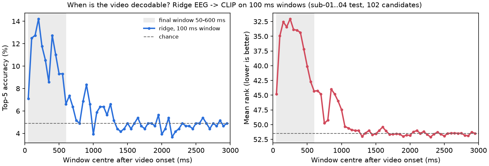

# EEG encoding

This section covers the EEG side of the pipeline: how a preprocessed EEG trial becomes a vector that can be compared with the candidate videos. The video side is fixed here: every video is a frozen CLIP ViT-B-32 embedding (open_clip 3.3.0, `ViT-B-32` / `openai`, mean over 8 frames). The EEG encoder maps each trial into that 512-dimensional CLIP space, and the 102 candidates are ranked by cosine similarity.

```
video ──► frozen CLIP ViT-B-32 ──────────────────────────────► 512-d vector ─┐
                                                                              ├─► cosine similarity ─► ranking of 102 videos
EEG ──► preprocessing ──► EEG encoder (trained, this section) ─► 512-d vector ─┘
```

**Final result** (development test sets of sub-01 to sub-04, 102 candidates each):

| | Top-1 | Top-5 | Mean rank |
|---|---|---|---|
| **Submission: 3-vote ensemble** | **17.6 %** | **47.8 %** | **11.5** |
| Same ensemble with the earlier preprocessing (band-pass + average reference) | 13.2 % | 43.1 % | 14.2 |
| Organisers' baseline (AlexNet forward model, sub-01 only) | 3.9 % | 11.8 % | – |
| Chance | 1.0 % | 4.9 % | 51.5 |

## Evaluation protocol

All numbers in this section use the same protocol, which mirrors how sub-05 and sub-06 are scored:

- **Training:** the training splits of all six subjects (5,650 trials, 1,000 videos). Sub-05 and sub-06 have labeled training data, so they are not unseen subjects.
- **Scoring:** the test splits of sub-01 to sub-04 (4 × 102 recordings). Each recording ranks the 102 test videos (1001–1102), none of which appear in training. Test splits are never used for training or model selection beyond the choices reported here.
- **Metrics:** top-1, top-5 (both scored by the jury), and mean rank of the correct video (1 = best, chance 51.5). Mean rank uses every recording's full position and is far less noisy than top-1.
- **Noise level:** with 408 recordings, top-1 has a standard error of about ±1.3 percentage points. Decisions between variants use **paired tests** on the same recordings (exact McNemar test on hits, sign test on ranks), which cancel most of that noise.
- **Hyperparameters that need tuning** (the weight between pooled and per-subject ridge) are chosen by cross-validation on the training data, not on the development test sets.

## Data properties that shape the encoder

Two properties of the test recordings matter for any EEG encoder:

- **The average response is inverted.** In every subject and all 17 channels, the mean evoked response of the test split correlates at r = −0.72 to −0.92 with that of the training split. The test recordings also have about 0.65× the amplitude and a cleaner evoked response, which suggests they are averages over repeated presentations.
- **The stimulus-specific signal keeps its sign.** In an early check with simple low-level video features, decoding the test recordings as they are works (top-1 3.9 %), while flipping their sign drops it below chance (0.2 %). So only the shared, stimulus-independent part is inverted.

Preprocessing therefore removes each split's own mean response and scales each subject and split separately. Both are label-free normalisations of the test recordings, which the challenge rules allow.

## 1. EEG features: what carries the information

The first encoder is a ridge regression from hand-crafted EEG features to the CLIP embedding, trained on all six subjects together. A sweep over feature types and time windows (`python -m src.xsubj.sweep_features`, pooled ridge, no per-candidate normalisation):

| Features | Top-1 | Top-5 | Mean rank |
|---|---|---|---|
| Amplitude, 50 ms bins, 0–1 s + band power (first version) | 7.6 % | 28.4 % | 21.5 |
| Amplitude, 50 ms bins, 0–1 s | 8.1 % | 26.7 % | 20.8 |
| Amplitude, 20–25 ms bins, 0–1 s | 10.5 % | 29.7 % | 20.1 |
| Amplitude, 10 ms (every sample), 0–1 s | 8.3 % | 25.7 % | 20.8 |
| **Amplitude, 10 ms, 50–600 ms (chosen)** | **9.8 %** | **33.1 %** | **18.9** |
| Amplitude, 10 ms, 0–700 ms | 10.3 % | 31.4 % | 18.8 |
| Amplitude, 10 ms, 50–500 ms | 9.1 % | 29.7 % | 19.0 |
| Amplitude, 50 ms bins, 0–3 s | 6.1 % | 21.1 % | 26.9 |
| Amplitude, 20 ms over 0–1 s + 100 ms over 1–3 s | 7.8 % | 26.0 % | 21.6 |
| Log band power only (δ θ α β γ, whole window) | 0.7 % | 5.4 % | 49.9 |
| Riemannian tangent-space covariance, broadband | 0.7 % | 4.7 % | 50.9 |
| Riemannian covariance, 4-band filter bank | 1.2 % | 6.4 % | 47.6 |
| Amplitude + Riemannian filter bank | 5.9 % | 26.5 % | 23.3 |
| Time-resolved band power (θ α β envelopes, 100 ms bins) | 1.7 % | 5.9 % | 47.4 |
| Chosen amplitude features + time-resolved band power | 7.8 % | 25.5 % | 21.6 |

**Finding:** the decodable information is entirely in the **phase-locked amplitude** of the evoked response. Every power- or covariance-based feature is at chance on its own and hurts when added. The chosen window (50–600 ms, every 10 ms sample, 17 channels → 935 features) is the organisers' window, confirmed independently here. 0–700 ms performs the same.

### When is the video decodable?



Ridge trained on a sliding 100 ms window (two 50 ms bins per channel) over the full 3 s:

- Information appears at about **50 ms**, peaks at **150–300 ms** (best mean rank 32.0 at 200–300 ms, best top-5 14.2 % at 150–250 ms) and fades over 400–600 ms.
- A small second bump around **800–1,000 ms**, then nothing: from about 1.1 s on, every window is at chance, although the videos last 3 s.

The decodable signal is the response to the video's **onset**, in the range of the P1/N1 and the following components, not a response that tracks the video's content over time.

## 2. Neural encoders

Contrastively trained encoders (InfoNCE against all training videos plus a cosine term, per-subject channel-mixing layer, early stopping on held-out training videos), all on the 50–600 ms window:

| Encoder (alone, per-candidate normalisation) | Top-1 | Top-5 | Mean rank |
|---|---|---|---|
| ShallowConvNet, 5 seeds | 4.4–7.4 % | 22.1–24.5 % | 22.6–23.9 |
| MLP on the flattened trial, 3 seeds | 6.4–9.6 % | 26.2–29.4 % | 20.5–20.8 |
| EEGNet | 4.2 % | 21.3 % | 24.1 |
| Pooled ridge (for comparison) | 9.8 % | 32.4 % | 18.0 |

**Finding:** no neural encoder beats the linear ridge on its own. Of the networks, the simplest (an MLP on the raw amplitudes) is best and the convolutional ones are weakest. With about 5,600 noisy single trials, model capacity is not the bottleneck.

**Cross-subject averaging as augmentation** (replacing a trial by its average with same-video trials of 1–3 other subjects, to mimic the cleaner test recordings) brought no gain, neither for the encoders (ShallowConvNet mean rank 25.1 with vs 24.1 without) nor as extra training data for ridge (mean rank 18.9 without vs 19.1–21.2 with).

A pitfall worth noting: with averaged copies in the training set, `RidgeCV`'s built-in leave-one-out picks a far too small regularisation (1e2 instead of 1e4), because each held-out example has near-copies in training. With the regularisation fixed, averaging is simply neutral.

## 3. Ensembles

Although the encoders are weaker, they make different errors than ridge. Averaging the predicted CLIP vectors (each model unit-normalised, encoders averaged into one vote, equal weight with ridge):

| Ensemble (per-candidate normalisation) | Top-1 | Top-5 | Mean rank |
|---|---|---|---|
| Pooled ridge alone | 9.8 % | 32.4 % | 18.0 |
| Ridge + 1 ShallowConvNet | 10.5 % | 35.3 % | 16.8 |
| Ridge + 5 ShallowConvNets | 10.5 % | 34.8 % | 16.6 |
| Ridge + 3 MLPs | 11.0 % | 35.0 % | 16.6 |
| Ridge + all 9 encoders | 10.8 % | 36.3 % | 16.2 |

Against ridge + 1 ShallowConvNet, the 9-encoder ensemble improves the mean rank significantly (better in 172 recordings, worse in 120, p = 0.003); top-1 and top-5 move in the same direction but within noise.

**Per-candidate normalisation:** before ranking, each candidate video's similarities are z-scored over the subject's 102 test recordings. This removes "hub" videos that score high for every recording and acts as a label-free per-subject calibration. Paired against no normalisation (ridge + 1 encoder): top-1 21 vs 23 recordings (p = 0.88), top-5 35 vs 26 (p = 0.31), mean rank 17.7 → 16.8. It is neutral for top-1 and positive in expectation for top-5, so it is on in the submission.

## 4. Subject-specific models

The largest single gain came from training ridge **per subject**, on that subject's own ~950 training trials only:

| Ridge (per-candidate normalisation) | Top-1 | Top-5 | Mean rank |
|---|---|---|---|
| Pooled (all six subjects, 5,650 trials) | 9.8 % | 32.4 % | 18.0 |
| Per subject (~950 trials each) | 13.5 % | 36.8 % | 17.2 |
| Pooled + per subject, equal weight | 14.0 % | 40.9 % | 15.0 |
| One ridge on shared + subject-specific feature copies (Daumé 2007) | 14.7 % | 38.5 % | 16.2 |

A model that sees six times less data, but only from the right person, decodes better. The best results combine both: the pooled model captures what subjects share, the per-subject model their individual topography and timing.

**Weighting** between pooled and per-subject ridge was chosen by 5-fold cross-validation over training videos (no development test data). The optimum is **equal weight** (normalised CV rank 0.263, vs 0.284 pooled only and 0.289 per-subject only). Per-subject optima only range from 0.4 to 0.6, and the curves are flat there, so per-subject weights gain nothing.

**Per-subject fine-tuning of the encoders** (all parameters, lr 1e-4, early stopping on the subject's held-out training videos) changes little: alone, mean rank improves slightly (ShallowConvNet 23.9 → 23.3, MLP 20.7 → 20.2), but inside the 3-vote ensemble (encoder vote from these two encoders) there is no measurable gain (top-1 12.0 → 12.3 %, top-5 42.4 → 42.2 %, mean rank 14.5 → 14.5, p = 0.17). The subject-specific part is already covered by the per-subject ridge, so the submission keeps the pooled encoders.

## 5. Preprocessing

Sections 1–4 used a conventional pipeline: 0.5–40 Hz band-pass, average reference, then split-wise mean removal, scaling and Euclidean alignment. A sweep over these steps (`python -m src.xsubj.sweep_preprocess`) scores each variant with the two ridge votes, which train in seconds. The main criterion is 5-fold cross-validation over training videos (normalised mean rank, 0 = best, 0.5 = chance), so the choice does not rest on the development test sets. Those are reported for confirmation only.

| Preprocessing (ridge votes) | CV rank | Top-1 | Top-5 | Mean rank |
|---|---|---|---|---|
| Band-pass 0.5–40 Hz + average reference (earlier) | 0.263 | 13.7 % | 40.9 % | 15.0 |
| Band-pass 0.1–40 Hz | 0.287 | 11.8 % | 36.8 % | 15.9 |
| Band-pass 1–40 Hz | 0.262 | 13.5 % | 39.2 % | 16.0 |
| High-pass 0.1 Hz only | 0.283 | 12.0 % | 38.2 % | 15.5 |
| No filter | 0.241 | 14.7 % | 45.3 % | 13.7 |
| Low-pass 40 Hz only | 0.241 | 14.7 % | 45.8 % | 13.6 |
| **Low-pass 40 Hz only, no average reference (chosen)** | **0.233** | **15.9 %** | **45.6 %** | **12.5** |
| … and no Euclidean alignment | 0.269 | 12.0 % | 38.5 % | 14.9 |
| … with per-trial detrending | 0.235 | 15.4 % | 42.6 % | 14.4 |
| … with per-trial demeaning | 0.238 | 14.5 % | 45.3 % | 14.1 |

**Finding:** every high-pass filter hurts compared with none. The effect is not monotonic in the cut-off: 0.1 Hz is worse than 0.5–1 Hz, which suggests filter edge transients on the short 3 s epochs, rather than a pure loss of slow signal (not tested further). Average referencing also hurts, while Euclidean alignment remains clearly useful. The chosen variant is best on both the cross-validation and the development test sets.

All nine encoders were then retrained with the chosen preprocessing (same architectures, seeds and training settings). Against the same ensemble with the earlier preprocessing, paired on the same 408 recordings:

| Full ensemble | Top-1 | Top-5 | Mean rank |
|---|---|---|---|
| Earlier preprocessing | 13.2 % | 43.1 % | 14.2 |
| **Low-pass only, no average reference** | **17.6 %** | **47.8 %** | **11.5** |
| Paired test | 47 vs 29 hits, p = 0.050 | 58 vs 39 hits, p = 0.067 | better in 214, worse in 141, p = 0.0001 |

## 6. Final configuration

The submission combines three votes with equal weight, then applies per-candidate normalisation:

1. **9 neural encoders** (5× ShallowConvNet, 3× MLP, 1× EEGNet), averaged into one vote
2. **Pooled ridge** on all six subjects' training splits
3. **Per-subject ridge** on the subject's own training split

| Development test | sub-01 | sub-02 | sub-03 | sub-04 | Mean |
|---|---|---|---|---|---|
| Top-1 | 18.6 % | 21.6 % | 12.7 % | 17.6 % | **17.6 %** |
| Top-5 | 47.1 % | 49.0 % | 44.1 % | 51.0 % | **47.8 %** |

Preprocessing: 40 Hz low-pass (no high-pass), no average reference, 0–1 s window, 100 Hz, removal of each split's mean response, scaling, clipping at ±6 SD, Euclidean alignment (all label-free, per subject and split). Against the earlier ridge + 9 encoders submission, adding the per-subject ridge improved top-5 and mean rank significantly; the preprocessing change then improved the mean rank significantly again (section 5).

Reproduction (from the repository root; the weights of all models and the CLIP features are versioned):

```bash
python -m src.xsubj.submit                    # submission files for sub-01..06, scores sub-01..04
python -m src.xsubj.eval --models ridge       # pooled ridge, official protocol
python -m src.xsubj.sweep_features            # feature sweep (add --tmax 3.0 --curve for the decoding curve)
python -m src.xsubj.sweep_preprocess          # preprocessing sweep (section 5)
```

The training commands for each encoder are listed under `submit:` in `configs/xsubj.yaml`.

## Limitations and failure cases

- **Small development set.** 408 scored recordings give about ±1.3 points of noise on top-1. Several reported differences (normalisation, ensemble size) are trends rather than proven effects; only the paired tests marked significant should be read as such.
- **Subjects differ a lot.** Top-1 ranges from 12.7 % (sub-03) to 21.6 % (sub-02) in the final model. Sub-03 is the hardest subject in most variants.
- **Sections 1–4 use the earlier preprocessing.** The feature, encoder and ensemble comparisons were not rerun after the preprocessing change; their absolute numbers are lower than the final ones, and only the relative conclusions carry over.
- **Training and test recordings differ.** Training trials are single presentations, test recordings appear to be averages. The models are trained on noisier data than they are scored on, and the cross-validated weight between pooled and per-subject ridge is chosen on single trials.
- **Only the onset response is decoded.** Nothing after about 1.1 s carries information, so any content that only appears later in a 3 s video is invisible to these models.
- **Validation leak in fine-tuning.** The early-stopping set of the per-subject fine-tuning contains videos the pooled encoder was trained on, so its validation scores (0.86–0.93) are optimistic. This only affects when training stops, not the development test numbers.

## Takeaways

1. The EEG signal that identifies a video is the **phase-locked evoked response from about 50 to 600 ms after onset**, peaking at 150–300 ms. Oscillatory power and spatial covariance carry nothing usable.
2. At this data size, a **linear model beats deep networks**; the networks only help as additional, differently-erring ensemble members.
3. **Subject-specific models matter more than more data**: per-subject ridge on ~950 trials beats pooled ridge on 5,650, and combining both is best.
4. **Less preprocessing is better**: a high-pass filter and average referencing remove stimulus information; only a 40 Hz low-pass, label-free per-split normalisation and Euclidean alignment help.
5. **Careful statistics are part of the method**: with 102 candidates and 408 recordings, paired tests and cross-validated choices separate real gains from noise.
